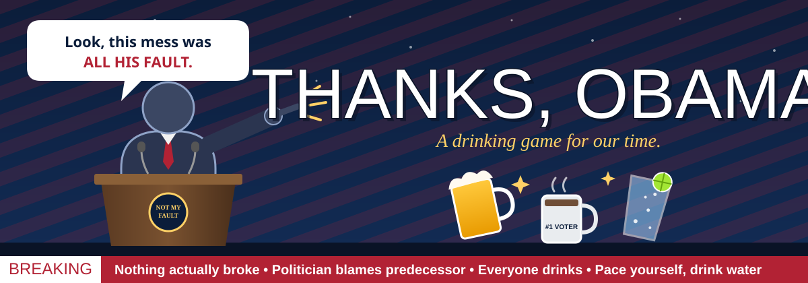

  

# Thanks, Obama.

A drinking game for watching politicians blame someone else, promise everything, and answer nothing.

Any drink works: water, seltzer, juice, coffee, beer. Everyone picks their own drink and sets their own pace.

## Setup

- Watch a debate, press conference, rally, hearing, or cable news panel.
- Everyone gets a drink.
- Nobody drinks for another person unless a rule says so.

## Core Rule: The Blame Rule

When a politician blames a predecessor, the other party, the media, or "the previous administration" for something, **everyone says "Thanks, Obama!" and takes a sip.** It counts no matter who is blaming whom.

## Sips (1 sip each)

| Trigger | Sips |
|---|---|
| "Let me be clear" or "Make no mistake" | 1 |
| "Hardworking families" or "Main Street" | 1 |
| "Both sides" | 1 |
| "At the end of the day" | 1 |
| "With all due respect" before a disrespectful statement | 1 |
| Mentioning humble roots or a small-town upbringing | 1 |
| "My opponent" described as "radical" or "out of touch" | 1 |
| A talking point repeated word for word by two speakers | 1 |

## Gulps (1 real drink)

| Trigger | Gulp |
|---|---|
| Answering a question by pivoting to a different topic | 1 |
| "I'm not going to get into hypotheticals" | 1 |
| "That's a great question" followed by a non-answer | 1 |
| A story about "a woman I met in [swing state]" | 1 |
| "Washington is broken" from someone who works in Washington | 1 |
| Citing a statistic with no source | 1 |
| "I'm a fighter" or "I'll fight for you" | 1 |

## Finish Your Drink (rare events)

- A politician says "I misspoke" and then repeats the same claim.
- Someone says "this is not about politics" about something that is entirely about politics.
- Any politician says "I'm not a politician."
- Someone shows a chart nobody in the room can read.

## The Biden Blame Rule

When a politician blames Joe Biden, his administration, or "the last four years," **everyone says "Thanks, Biden!" and takes a sip.**

| Blame count by one speaker | Penalty |
|---|---|
| 1st mention | 1 sip |
| 2nd mention | 2 sips |
| 3rd mention in one appearance | 1 gulp, and that speaker's bingo is complete |
| Blaming Biden for something that clearly happened before his term | Finish your drink (the Time Machine Clause) |
| Blaming Biden and Obama in the same sentence | Everyone drinks and says "Thanks, Obama *and* Biden!" |

The count resets when the speaker changes.

**Bonus triggers:**

- **The Pivot:** The question wasn't about Biden, and the answer is. Take a gulp.
- **The Inheritance:** "I inherited this mess" or "the mess we were handed." Take a sip.
- **The Rebuttal:** A Biden-aligned speaker responds by blaming the previous administration. Everyone drinks.

## The Obama Blame Rule (the Yahtzee)

When a politician blames Barack Obama, his administration, or "eight years of the Obama era" for a current problem, **the game stops. Everyone shouts "THANKS, OBAMA!" together and takes a full drink.**

This is the rarest and most prestigious trigger in the game. Reaching back more than a decade takes commitment.

| Event | Penalty |
|---|---|
| First Obama blame of the night | Everyone drinks a full drink and shouts "THANKS, OBAMA!" |
| Second Obama blame by the same speaker | Everyone finishes their drink |
| Third Obama blame in one appearance (**The Royal Flush**) | The person with the most correct calls tonight picks a dare or a mixed drink for everyone else |
| Blaming Obama for something that happened under three or more administrations since (the Time Machine Clause) | Finish your drink, then refill it with something terrible |

**Combos:**

- **The Full House:** The same speaker blames Obama and Biden in one answer. Everyone drinks, shouts "THANKS, OBAMA *AND* BIDEN!", and the first person to call it picks the next trigger word for the night.
- **The Grand Slam:** One politician blames Obama, Biden, and "the media" in one breath. Everyone stands, drinks, and gives a slow clap.

**Pre-call bonus:** Anyone who correctly calls an Obama blame before the sentence ends skips their next drink.

## Special Rules

- **Flag on the Play:** If you think a trigger counted and nobody drank, call it. The room votes. If it's upheld, everyone drinks. If not, you take a sip.
- **Waterfall Clause:** If three triggers happen within 30 seconds, everyone drinks until the person to their left stops.
- **Pundit Penalty:** When a commentator says "this changes everything," the oldest person in the room drinks.
- **The Cable News Cheat:** Breaking-news banners only count if the word "BREAKING" is on screen and nothing actually broke.
- **Fairness Clause:** Blame counts the same no matter who is speaking, what party they belong to, or who they're blaming. A speaker blaming their own party's predecessor counts the same as anyone else.

## House Rules

- Keep it nonpartisan. Anyone who starts a real argument drinks a glass of water and stays quiet for one round.
- Pace yourself. If you're drinking alcohol, alternate with water, eat something, and don't drive.
- Anyone can switch to a non-alcoholic drink at any time, no questions asked.
- This is a joke. It isn't an endorsement of anyone.

## Contributing

Got a stereotypical political phrase that deserves a sip? Open an issue or send a pull request with the phrase and a suggested penalty.

## License

MIT. Play responsibly.